<!-- Header -->
<picture>
  <source media="(prefers-color-scheme: dark)" srcset="assets/header-dark.svg">
  <source media="(prefers-color-scheme: light)" srcset="assets/header-light.svg">
  
</picture>

<!-- Typing SVG -->
<p align="center">
  <a href="https://github.com/bingqin2">
    
  </a>
</p>

<!-- Links -->
<p align="center">
  <a href="https://bingqin2.github.io">
    
  </a>&nbsp;
  <a href="https://github.com/bingqin2?tab=repositories">
    
  </a>&nbsp;
  <a href="https://github.com/kestra-io/kestra/pull/22796">
    
  </a>
</p>

<br>

## `> about_me.json`

I'm an MCS student at the **University of Illinois Urbana-Champaign** (2026–2028). I build backend and distributed systems with **Java, Python, Go, and TypeScript**: workflow engines, real-time collaboration, and LLM API gateways. I also explore how AI agents can support software development.

**Looking for Summer 2027 software engineering internships in the US.**

```json
{
  "name": "Bingqin Wang",
  "education": "Master of Computer Science, UIUC (2026–2028)",
  "focus": ["Backend systems", "Distributed systems", "Developer tools", "AI agents"],
  "languages": ["Java", "Python", "Go", "C++", "TypeScript", "JavaScript", "SQL"],
  "backend": ["Spring Boot", "FastAPI", "Node.js", "PostgreSQL", "MySQL", "Redis", "Kafka"],
  "tools": ["Docker", "Linux", "Git", "GitHub Actions", "CI/CD"]
}
```

<br>

## `> tech_stack`

<p align="center">
  <a href="https://skillicons.dev">
    
  </a>
</p>

<br>

## `> featured_work`

| Project / Contribution | Highlights | Stack |
| :--- | :--- | :--- |
| **[PatchPilot](https://github.com/bingqin2/PatchPilot)** | A self-hosted GitHub issue-to-PR agent that generates patches, runs tests, and opens pull requests for review. | Java · Spring Boot · MySQL · Docker |
| **[TermScope](https://github.com/bingqin2/hy3-termscope)** | Process evaluation and causal error localization for LLM terminal agents on Terminal-Bench 2.0. | Python · Agent evaluation |
| **Distributed Workflow Engine**<br>Private team project | DAG execution engine for GitHub activity analytics: schedulers and workers coordinated through PostgreSQL transactions, task leases, and heartbeats, with dynamic task expansion, asynchronous triggers, partitioned backfills, and fault-injection tests. | Python · asyncio · PostgreSQL · Docker |
| **Real-Time Collaborative Markdown Editor**<br>Private team project | Operational transformation engine in Go and TypeScript, a WebSocket sync protocol with operation IDs, acknowledgments, and durable deduplication, IndexedDB recovery after disconnects, and transactional logs plus versioned snapshots in PostgreSQL. | Go · TypeScript · PostgreSQL · WebSocket · IndexedDB |
| **[Apache Airflow](https://github.com/apache/airflow)**<br>Open-source contributions | Seven merged pull requests in the Amazon, Google, and FAB providers: failure-path and serialization tests for the Step Functions trigger ([#72570](https://github.com/apache/airflow/pull/72570)), a pickle round-trip fix for provider exceptions ([#72824](https://github.com/apache/airflow/pull/72824)), a session leak fix in the FAB permissions read ([#72950](https://github.com/apache/airflow/pull/72950)), response logging in HttpToS3Operator and HttpToGCSOperator ([#72951](https://github.com/apache/airflow/pull/72951), [#72952](https://github.com/apache/airflow/pull/72952)), the retry settings of GCSTimeSpanFileTransformOperator applied to downloads and uploads ([#72953](https://github.com/apache/airflow/pull/72953)), and BigQuery check triggers that keep polling while the job runs ([#74305](https://github.com/apache/airflow/pull/74305)). Five more under review. | Python · AWS · Google Cloud · pytest |
| **[Kestra](https://github.com/kestra-io/kestra)**<br>Open-source contributions | A merged fix for executions that stayed running forever when a flowable task had only disabled tasks left to run, such as a `finally` block or a `Switch` case ([#22796](https://github.com/kestra-io/kestra/pull/22796)). A second fix is under review: tasks with `retry` in an `errors` or `finally` block never retried and left the execution stuck ([#22797](https://github.com/kestra-io/kestra/pull/22797)). | Java · Micronaut · JUnit |

**Explore:** [PatchPilot demo](https://github.com/bingqin2/patchpilot-demo-java) · [TermScope report and results](https://bingqin2.github.io/hy3-termscope/) · [All repositories](https://github.com/bingqin2?tab=repositories)

<br>

## `> contributions`

<picture>
  <source media="(prefers-color-scheme: dark)" srcset="https://raw.githubusercontent.com/bingqin2/bingqin2/output/github-snake-dark.svg">
  <source media="(prefers-color-scheme: light)" srcset="https://raw.githubusercontent.com/bingqin2/bingqin2/output/github-snake.svg">
  
</picture>

<br>

<!-- Footer -->
<picture>
  <source media="(prefers-color-scheme: dark)" srcset="assets/footer-dark.svg">
  <source media="(prefers-color-scheme: light)" srcset="assets/footer-light.svg">
  
</picture>

<p align="center"><sub>Profile layout adapted from <a href="https://github.com/alsiam/readme">alsiam/readme</a>.</sub></p>
